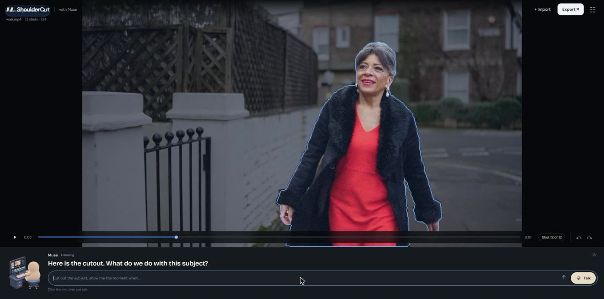

<div align="center">


# ShoulderCut

### You direct. Muse cuts.

**Meta Global AI Developer Hackathon** · Indie Developer track · *Build for Your World*



</div>

---

A director brings the intent, not the keyboard: *"cut there"*, *"no, go back"*,
*"make it blue"*. The editor does the work. ShoulderCut is named for that
working relationship — the over-the-shoulder note that changes the cut.

**You are the director. Muse is the editor** — the small figure up there,
turning round when you speak and working on when you don't. Say *"cut out the
subject and put a red jacket on her"* and Muse tracks the subject with
**SAM 3.1**, writes the shader, and hands the segment to whichever generation
backend is reachable. There is no effects catalogue: **every effect is WGSL the
model authors on the spot**, compiled live in your browser.

| | |
| --- | --- |
| **Talk, don't hunt for menus** | A realtime voice session, or type in the same box. Answers come back while an edit is still running. |
| **The subject, not the frame** | SAM 3.1 masks drive every effect and every replacement, so the rest of the picture is untouched. |
| **Effects written, not chosen** | No catalogue. Muse Wonder writes WGSL against a documented interface, and a failed compile never breaks the preview. |
| **Free on your GPU, or hosted** | Local ComfyUI costs nothing. No GPU? The same request routes to fal.ai. Measured: $0.00 to $4.56 a pass. |
| **Your footage stays yours** | Local-first by design. No hosted instance, and no API key ever reaches the browser. |

## The Meta models, and what each one does

One `MODEL_API_KEY`, four services, each doing a distinct job. The mascot is
named after two of them: **Muse Wonder** writes the shaders, **Muse Spark**
carries the conversation.

| Model | What it does here | Where |
| --- | --- | --- |
| **SAM 3.1** | Segments and tracks a subject from a plain noun phrase. The mask is what makes "her jacket" mean her jacket. | [`server/sam.ts`](server/sam.ts) |
| **Muse Wonder** | The editor itself: reads the instruction, picks the tools, writes the WGSL. | [`server/muse-runner.ts`](server/muse-runner.ts) |
| **Muse Spark** | The conversation. Small and fast enough to keep talking through a long render. | [`server/conversation.ts`](server/conversation.ts) |
| **Meta ASR** | Speech to text, for captions and for the recorded-instruction fallback. | [`server/transcribe.ts`](server/transcribe.ts) |

## Where to read more

| | |
| --- | --- |
| [docs/SPEC.md](docs/SPEC.md) | The specification, kept current with the build |
| [docs/fx-interface.md](docs/fx-interface.md) | The WGSL contract Muse writes against |
| [docs/operations.md](docs/operations.md) | What runs, what it costs, who pays |
| [docs/remote-access.md](docs/remote-access.md) | Letting someone else drive your editor |
| [docs/dogfooding.md](docs/dogfooding.md) | The harness that measures every backend |
| [docs/demo-script.md](docs/demo-script.md) | The three-minute demo, line by line |
| [docs/costs.md](docs/costs.md) | What spends money, per feature |
| [docs/character-replacement-research.md](docs/character-replacement-research.md) | Why replacement does not use mask inpainting |
| [AGENTS.md](AGENTS.md) | How changes get made here: fix the class, never the case |

Status: submitted 4 November 2026, feature-complete on the P0 scope, every
check green — 51 node tests, 19 python tests, a clean typecheck and a green
build.

## Run it

**You need:** Node 22+, `ffmpeg` and `ffprobe` on PATH, and — for voice only —
[uv](https://docs.astral.sh/uv/). An NVIDIA GPU with
[ComfyUI](https://github.com/comfyanonymous/ComfyUI) is optional: without one,
generation runs on hosted providers instead.

```bash
git clone https://github.com/EtienneLescot/shouldercut && cd shouldercut
npm install
cp .env.example .env     # then fill in the keys below
npm run demo
```

`npm run demo` starts the editor on 5173 and, if configured, the LiveKit server
and the voice worker, then prints the URL. `npm run dev` starts the editor
alone. Open it in Chrome or Edge, drag in a local MP4 or WebM, and ask for any
effect — *"add an explosion effect in the middle"*. Muse Code must be installed
and logged in on this machine. For voice, click **Talk** once and speak freely;
click the microphone again to end the call.

### Which keys, and which you can skip

Every key goes in `.env`, which is gitignored. `.env.example` lists them all
with a comment each.

| Key | Needed for | Where |
| --- | --- | --- |
| `MODEL_API_KEY` | **Required.** SAM 3.1 masks, voice commands, captions | Meta Model API |
| `MUSE_API_KEY` | **Required** unless the Muse CLI is already logged in | Muse |
| `FAL_KEY` | Hosted generation. Skip it if you run ComfyUI locally | [fal.ai](https://fal.ai) |
| `ELEVEN_API_KEY` | The mascot's voice | [elevenlabs.io](https://elevenlabs.io) |
| `GOOGLE_API_KEY` | TTS fallback when ElevenLabs is out of quota | [AI Studio](https://aistudio.google.com) |
| `LIVEKIT_*` | Voice transport | LiveKit Cloud, or the local `--dev` server |
| `COMFY_URL` | A ComfyUI that is not on `127.0.0.1:8188` | — |

Typing to the editor needs the first two. Everything else is additive:
no `ELEVEN_API_KEY` means no voice, not a broken app.

### What it costs

Generation is the only thing that bills. Measured by `tools/dogfood.ts` over
one full pass of three clips:

| Backend | Where | One pass |
| --- | --- | --- |
| `vace-local`, `scail`, `scail-animate` | your GPU | **free** |
| `vace`, `wan-animate` | fal.ai | $0.61 |
| `kling-o3` | fal.ai | $2.55 |
| `recast` | fal.ai | $4.56 |

`GEN_DRY_RUN=1` prepares every provider input for real and submits nothing,
which is how the harness stays free.

### Checks

```bash
npx tsc --noEmit      # typecheck
npm test              # node tests (need ffmpeg and ffprobe on PATH)
npm run test:voice    # 19 python tests
npm run build
```

`npm run diagnostics` summarises the local latency journals in `.runtime/`,
which record stage durations, trace ids, status and model names — never
prompts, transcripts, media or credentials. `.runtime/` is not committed.

## Built during the hackathon

Everything in this repository is written from scratch during the event
(Oct 27 – Nov 4, 2026), except the declared dependencies below. The six pieces
that carry the product:

- **Free-form FX interface.** Agent-written WGSL compiled live over MCP, with
  an injected stdlib (noise, SDF, lighting, blur, compositing), 16 free
  params, temporal history feedback and a `validate_shader` dry-run compile.
  No built-in effects catalogue — [docs/fx-interface.md](docs/fx-interface.md).
- **SAM 3.1 mask tracks.** `track_object` uploads the clip once through the
  bridge, SAM tracks the prompt, and masks are decoded server-side and stream
  into the render worker behind `maskAt()`.
- **Render worker.** Mediabunny demux, direct WebCodecs `VideoDecoder`,
  frame-accurate seek and step, WebGPU presentation from `VideoFrame`.
- **True 3D for agent shaders.** Background and foreground world planes
  (`layerUv`, `foreAt`, `backAt`) with a host-animated virtual camera for real
  parallax push-ins, raymarching helpers, and host-simulated GPU particles
  billboarded into the same world space.
- **Edit graph and export.** A server-side project document and agent
  operations over MCP (trim, split, move, delete, silence removal via ffmpeg,
  captions, undo and redo), plus MP4 export that replays the clip through the
  same WGSL pass chain as the preview — so the agent's shaders are rendered
  into the file, then muxed with the source audio, preset and captions.
- **Realtime voice.** LiveKit transports the selected microphone and neural
  speech; Meta Muse Voice streams partial transcripts. A separate editing
  supervisor shares the MCP tool surface with chat, so interrupting speech
  never cancels work already accepted.

Underneath them: a supervisor built on Muse Code (`muse exec`) hosting the
`shouldercut-fx` MCP server as its entire tool surface — 31 tools over
shaders, masks, the edit graph, generation and a researched technique registry
that prices every backend before spending. One harness serves chat and voice.
[docs/SPEC.md](docs/SPEC.md) has the full list, the day-by-day plan, and what
was cut on purpose (§11): Muse Image plates as shader inputs, dissolve
transitions, caption style variants, filler-word removal, reframing beyond the
three export presets, music-bed ducking.

## Pre-existing dependencies

Declared dependencies that existed before the event. They are plumbing, not
hackathon work, and are never presented as built during the event.

- `stimm` (MIT, the author's own pre-existing published package), pinned to
  commit `5d7316b3513848b1121429a767add183f04f6036` (Oct 10, the same revision
  as the digital-twin example on etiennelescot.fr) — LiveKit
  VoiceAgent/Supervisor orchestration. The ShoulderCut editing adapter,
  command queue, browser integration and voice provider wiring are new.
- LiveKit client/server SDKs and Agents plugins — WebRTC, room dispatch,
  streaming Meta STT, ElevenLabs and Gemini TTS.
- `mediabunny` — media demuxing and `VideoDecoderConfig` extraction. Decoding,
  seeking, buffering and rendering around it are built during the event.
- `@meta-sam/parser` (Meta, SAM License) — official SAM 3 segmentation stream
  parser and mask codec, used server-side by the bridge. The SAM adapter, mask
  expansion, GPU upload and `maskAt()` wiring around it are built during the
  event.
- `@modelcontextprotocol/sdk` and `zod` — MCP server plumbing. Vite and
  TypeScript — build tooling.

External tools invoked, not bundled: `ffmpeg` (segment extraction, edge
control, silence detection, export mux), the Muse Code CLI (`muse exec`, the
supervisor), and optionally a local ComfyUI server with the SCAIL-2 and VACE
open-weight models for the local `edit_segment` backends.

Muse is played from hand-drawn poses in sprite atlases by `src/mascot.ts`:
turns toward you while waiting, waves now and then, works head-down while the
edit runs. Reduced-motion preferences keep the poses with less motion. The
character is Meta's Jolly, used here as an homage in a Meta hackathon entry;
the drawing is ours, and no Meta artwork is redistributed. ShoulderCut is not
affiliated with or endorsed by Meta.

MIT licensed, see [LICENSE](LICENSE).
